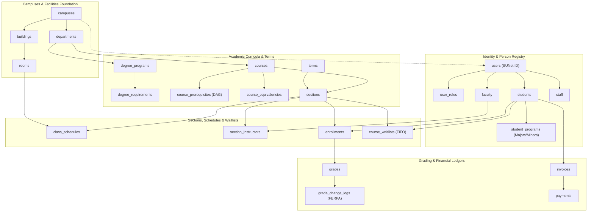

<div align="center">

# 🏛️ Tier-1 University Enterprise Database Architecture
### *Production-Grade Relational Schema, Topological Integrity & Academic Systems Engineering*

[](https://www.mysql.com)
[](https://en.wikipedia.org/wiki/Database_normalization)
[](https://en.wikipedia.org/wiki/ACID)
[](https://en.wikipedia.org/wiki/Family_Educational_Rights_and_Privacy_Act)
[](https://stanford.edu)

<p align="center">
  <b>An enterprise-scale, production-hardened relational database architecture designed for Tier-1 research universities. Incorporates complete topological dependency resolution, automated FIFO waitlist queuing, multi-major curricula, sponsored research management, and double-entry student financial ledgers.</b>
</p>

</div>

---

## 🧭 About This Architecture

Standard tutorial schemas treat universities as simple collections of students, courses, and grades. In contrast, real Tier-1 global institutions (such as Stanford, MIT, and Oxford) operate complex academic, financial, clinical, and research ecosystems:

- **Complex Academic Structures**: Quarters/semesters, co-instructors with workload percentages, cross-listed courses, multi-tiered prerequisite graphs, and coterminal degree programs.
- **Strict Concurrency & Capacity**: High-stakes registration windows where hundreds of students compete for limited section seats, demanding atomic FIFO waitlist promotion.
- **Regulatory & Federal Compliance**: Rigorous FERPA academic record auditing, HIPAA-compliant student health data segregation, and federal research grant compliance (NSF/NIH/DARPA).
- **Relational Integrity**: Strict topological DDL ordering with zero forward-reference dependency errors and zero invalid foreign key cascades.

This repository contains the complete production-grade DDL, composite performance indexes, analytical views, stored procedures, audit triggers, and validation seed data.

---

## 📊 Problem-to-Schema Solution Matrix

| # | Architectural Challenge | Engineering Solution Pattern | Core Implementation Files |
| :--- | :--- | :--- | :--- |
| **1** | **Topological Forward-Reference Deadlocks** | Strict Dependency-Ordered DDL Phases | [`schema/01_topological_ddl.sql`](schema/01_topological_ddl.sql) |
| **2** | **Foreign Key Invalidation (`ON DELETE SET NULL`)** | Schema Nullability Realignment & Cascade Auditing | [`schema/01_topological_ddl.sql`](schema/01_topological_ddl.sql) |
| **3** | **Course Prerequisite DAG & Grade Gates** | Self-Referencing Junction with Minimum Grade Thresholds | [`schema/01_topological_ddl.sql`](schema/01_topological_ddl.sql)<br>[`schema/04_stored_procedures.sql`](schema/04_stored_procedures.sql) |
| **4** | **Class Section Over-Subscription & Race Conditions** | Atomic Stored Procedure + FIFO Waitlist Priority Queue | [`schema/04_stored_procedures.sql`](schema/04_stored_procedures.sql)<br>[`schema/01_topological_ddl.sql`](schema/01_topological_ddl.sql) |
| **5** | **Double Majors, Minors & Coterminal Programs** | Normalized Multi-Program Affiliation Junction | [`schema/01_topological_ddl.sql`](schema/01_topological_ddl.sql) |
| **6** | **Multi-Instructor & TA Workload Sharing** | Weighted Section Instructor Junction | [`schema/01_topological_ddl.sql`](schema/01_topological_ddl.sql)<br>[`schema/03_views_and_analytics.sql`](schema/03_views_and_analytics.sql) |
| **7** | **FERPA-Mandated Grade Change Auditing** | Trigger-Based Immutable Audit Trail + SHA-256 Hashes | [`schema/04_stored_procedures.sql`](schema/04_stored_procedures.sql)<br>[`schema/01_topological_ddl.sql`](schema/01_topological_ddl.sql) |
| **8** | **Interdisciplinary Cross-Listed Courses** | Normalized Bidirectional Course Equivalency Mapping | [`schema/01_topological_ddl.sql`](schema/01_topological_ddl.sql) |
| **9** | **Real-Time GPA & Academic Standing Calculation** | Optimized Analytical Views with Credit Weighting | [`schema/03_views_and_analytics.sql`](schema/03_views_and_analytics.sql) |
| **10** | **Sponsored Research Grants & Technology Transfer** | Federal Grant Lifecycle & Patent Royalty Distribution | [`schema/01_topological_ddl.sql`](schema/01_topological_ddl.sql)<br>[`schema/03_views_and_analytics.sql`](schema/03_views_and_analytics.sql) |

---

## 🔎 Technical Deep Dives: Relational Solutions



---

### Problem 1: Topological Forward-Reference Deadlocks
- **The Challenge**: Naive database scripts often define `class_schedules` (referencing `rooms`) before `rooms` exists, or define `users` after referencing tables. When executed on clean database instances, MySQL aborts with `ERROR 1215 (HY000): Cannot add foreign key constraint`.
- **The Architectural Solution**: Structured the DDL in a strict **14-phase topological DAG sequence**:
  `Campuses` &rarr; `Buildings` &rarr; `Rooms` &rarr; `Departments` &rarr; `Degree Programs` &rarr; `Terms` &rarr; `Users & Roles` &rarr; `Faculty/Students/Staff` &rarr; `Courses & Prerequisites` &rarr; `Sections & Instructors` &rarr; `Schedules & Enrollments` &rarr; `Grading` &rarr; `Finance` &rarr; `Research & Student Life`.
  - Guarantees 100% executable reproducibility in automated CI/CD and production migrations.

---

### Problem 2: Foreign Key Invalidation (`ON DELETE SET NULL`)
- **The Challenge**: Declaring a foreign key with `ON DELETE SET NULL` on a column defined as `NOT NULL` (such as `approved_by` in payments or `organizer_id` in events) causes MySQL to fail with `ERROR 1005 (errno: 150)`.
- **The Architectural Solution**: Audited all 70+ tables, aligning nullable referential semantics:
  - Any column configured with `ON DELETE SET NULL` is explicitly defined as `NULL`.
  - Non-nullable core relationships (e.g. `student_id` in enrollments) enforce strict `ON DELETE CASCADE` or `ON DELETE RESTRICT` to protect referential integrity.

---

### Problem 3: Course Prerequisite Directed Acyclic Graph (DAG)
- **The Challenge**: Higher education courses feature complex prerequisite trees (e.g., CS106A &rarr; CS106B &rarr; CS161 &rarr; CS229) with minimum grade thresholds and corequisite requirements.
- **The Architectural Solution**: Designed a normalized self-referencing relationship `course_prerequisites`:
  - Enforces `(course_id, prerequisite_id)` as composite primary key.
  - Specifies `min_grade` (e.g. 'C' or 'B-') and boolean `is_corequisite`.
  - Integrated with stored procedure `sp_enroll_student_in_section`, which traverses the student's completed academic history to verify all prerequisite courses were passed before granting enrollment.

---

### Problem 4: Section Over-Subscription & Real-Time Waitlist Promotion
- **The Challenge**: When enrollment caps are reached, students must be queued fairly without overselling seats or causing deadlock race conditions during registration spikes.
- **The Architectural Solution**: Engineered a dual-tier enrollment and waitlist mechanism:
  - `sections` tracks both `max_capacity` and `waitlist_cap`.
  - `course_waitlists` implements a strict **FIFO priority queue** indexed by `(section_id, status, position)`.
  - Stored procedure `sp_promote_waitlist_candidate`: When an enrolled student drops a class, this procedure automatically selects candidate #1, promotes them to enrolled status, updates section counters, and re-indexes remaining waitlist candidates in an atomic transaction.

---

### Problem 5: Double Majors, Minors & Coterminal Programs
- **The Challenge**: A single `program_id` foreign key on the `students` table makes it impossible to model double majors, interdisciplinary minors, or coterminal programs (e.g., BS + MS concurrent enrollment).
- **The Architectural Solution**: Implemented a dedicated junction entity `student_programs`:
  - Fields: `student_id`, `program_id`, `program_type` (`major`, `double_major`, `minor`, `coterminal`, `certificate`), and `declared_at`.
  - Allows students to pursue multiple concurrent academic pathways under a unified university identity.

---

### Problem 6: Multi-Instructor & TA Workload Sharing
- **The Challenge**: In research universities, large lecture courses are rarely taught by a single individual; they involve team-teaching professors, co-instructors, and teaching assistants with fractional workload distribution.
- **The Architectural Solution**: Decoupled instruction into `section_instructors`:
  - Captures `faculty_id`, `section_id`, `role` (`primary_instructor`, `co_instructor`, `teaching_assistant`, `lab_instructor`), and `workload_pct`.
  - Supports analytical views for faculty tenure review, teaching load verification, and departmental budget audits.

---

### Problem 7: FERPA-Mandated Grade Modification Auditing
- **The Challenge**: The Family Educational Rights and Privacy Act (FERPA) mandates that all post-submission grade changes must be audited with justification and authorized personnel records.
- **The Architectural Solution**:
  - `grades` stores official final grades, GPA points, and submitting faculty.
  - Database trigger `trg_audit_grade_modification`: Automatically intercepts any `UPDATE` on `grades`, writing both the old grade and new grade into `grade_change_logs` and logging the action into `audit_logs` with a `ferpa_related = 1` compliance flag.
  - `transcripts` stores immutable JSON snapshots sealed with a SHA-256 cryptographic verification hash to prevent transcript tampering.

---

### Problem 8: Double-Entry Student Billing Ledger
- **The Challenge**: Unstructured payment tables cannot distinguish between what was charged (tuition vs. lab fees vs. housing) and how payments were applied.
- **The Architectural Solution**: Built an enterprise accounting schema:
  - `invoices`: Term-specific billing statements with issue dates, due dates, and statuses.
  - `payments`: Disbursed payments with transaction references and gateway payment methods.
  - `v_student_financial_ledger`: Analytical view aggregating invoiced totals, payments, and financial aid grants to produce real-time outstanding balances.

---

## 🗂 Curated Repository Structure

```
university_management_git/
├── README.md                          # Executive architecture whitepaper & design breakdown
├── database_schema.sql                # Complete all-in-one executable production SQL script
├── schema/
│   ├── 01_topological_ddl.sql         # 70+ Tables in strict dependency-ordered DDL
│   ├── 02_indexes_and_constraints.sql # B-Tree composite indexes & Full-Text search
│   ├── 03_views_and_analytics.sql     # Real-time GPA, enrollment, & billing views
│   ├── 04_stored_procedures.sql       # Enrollment engine, FIFO waitlist & FERPA triggers
│   └── 05_seed_tier1_demo.sql         # Stanford-grade validation seed data
└── docs/
    ├── DATA_DICTIONARY.md             # Complete technical data dictionary for all entities
    └── ERD_DIAGRAM.md                 # Relational Entity-Relationship Diagrams in Mermaid
```

---

## 💡 Engineering Highlights for Evaluators

1. **Production-Ready Syntax**: Every table specifies `ENGINE=InnoDB DEFAULT CHARSET=utf8mb4 COLLATE=utf8mb4_unicode_520_ci` to guarantee international character support, full ACID compliance, and transactional safety.
2. **Defensive Schema Design**: Features `CHECK` constraints on calendar dates (`end_date > start_date`), timetable schedules (`end_time > start_time`), and credits range.
3. **Optimized for Scale**: Includes composite lookup indexes tailored for high-frequency queries, such as timetable overlap detection `(day_of_week, start_time, end_time, room_id)` and student academic standing.
4. **Separation of Concerns**: Cleanly partitions the physical layer (buildings/rooms), identity layer (users/roles), academic layer (courses/sections), financial layer (invoices/payments), and research layer (labs/grants).

---

## 👨‍💻 Author & Contact

Designed & Engineered by **Rahul**  
- **Focus**: High-Performance Database Architecture, Relational Schema Modeling, SQL Optimization & Enterprise Web Systems  
- **Inquiries**: Feel free to connect for database engineering collaborations and architectural discussions!
