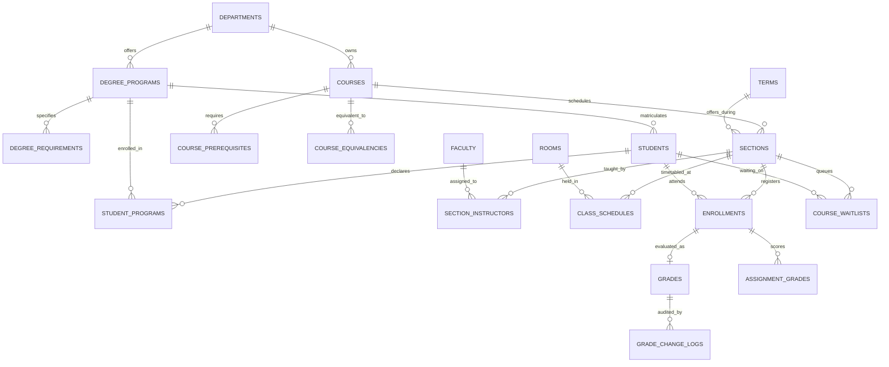
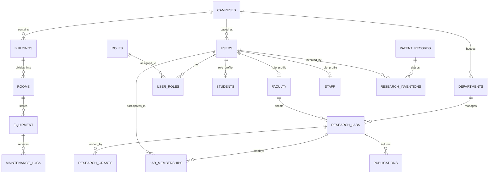
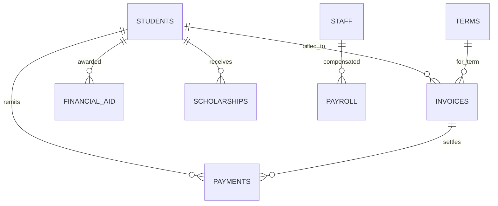

# 📊 University Enterprise Entity-Relationship Diagrams (ERD)

This document provides visual architectural representations of the core relational clusters within the Tier-1 University Management Database.

---

## 🎓 1. Academic & Curricular Architecture

---

## 🏛️ 2. Core Identity, Facilities & Research Cluster

---

## 💰 3. Financial Ledger & Student Accounts

